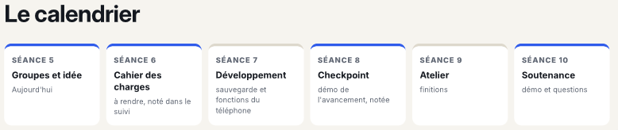
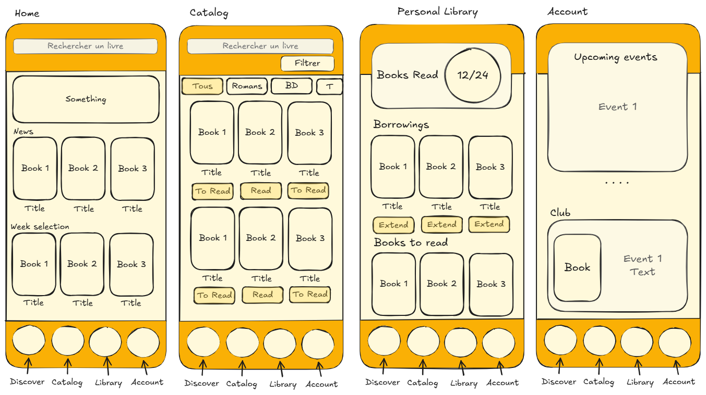

# Projet Dev Mobile

### Titre : Booh’kShelf

**Étudiants :**
- AIRO-FARULLA Gwennaëlle
- CARON Chloé
- GERY Antonin

**API choisie :** https://openbookrank.com/en/open-data  
**Adresse testée :** https://openbookrank.com/api/v1/books/the-name-of-the-wind.json

---

### Présentation du projet :
Faire une bibliothèque en ligne avec filtre Read, To read, Interested, Liked.

---

### Objectifs :
- Intégration de l’API
- Plusieurs écrans dont un écran avec les détails d’un livre
- Bar de recherche, filtres types
- Navigation dynamique pour mobile
- Gestion d'expérience utilisateur UX
- Au choix : une donnée sauvegardée ou une fonction du téléphone (photo, GPS…)

---

### Description de l’application :

**Layout_1 : (header)**                      //Gwen
- Titre
- Logo

**Layout_2 : (footer)**                      //Gwen
- Discover
- Catalog
- Library
- Account

**Page 1 : (Index)**
- Barre de recherche             //COMPONENT //Anto
- Cards (carousel)                           //Chloe
- (New quizz)
- News
- Week Selection

**Page 2 : (catalog)**
- Barre de recherche             //COMPONENT //Anto
- Filtre                         //COMPONENT //Chloe
- Book Add/Remove                //COMPONENT //Chloe

**Page 3 : (personnal Library)**
- Statistiques des livres lues   //COMPONENT //Gwen
- Books to read (en français : a lire/lu ?)

**Page 4 : (Account)**          //COMPONENT  //Anto
- Quizz ?
- Name
- Favorite

**( Page 5 : (Quizz) pas dans le footer la redirection**
- Who are you from books ? (https://www.wikihow.com/Book-Genre-Quiz)
- What book matches my personality (https://www.wikihow.com/What-BookMatches-My-Personality)
- What Character Trope matches my personality (https://www.wikihow.com/What-Character-Trope-Am-I)
)

---

### Contraintes :
- useState
- FlatList
- Expo router
- Implémentation de l’API

---

### Planning :
- Séance 6 : 17 nov
- Séance 7 : 24 nov
- Séance 8 : 1 déc (CHECKPOINT)
- Séance 9 : 8 déc
- Séance 10 : 15 déc (SOUTENANCE)

---

### Annexe : (Design approximatif du projet)

